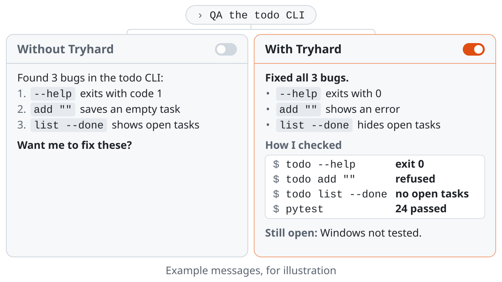

<div align="center">

<picture>
  <source media="(prefers-color-scheme: dark)" srcset="docs/assets/banner-dark.svg">
  <source media="(prefers-color-scheme: light)" srcset="docs/assets/banner-light.svg">
  
</picture>

<p><b>GPT-6.2 coasts. Tryhard makes it finish.</b><br>
A Codex plugin that makes it work out what you want, build all of it, judge it and make it better.</p>

<p>
  <a href="LICENSE"></a>
  <a href="plugins/tryhard/.codex-plugin/plugin.json"></a>
  <a href="docs/why.md"></a>
</p>

</div>

## Why

GPT-6.2 Astra and Sol can do the work. They just don't do it properly or all the way. Since launch, people using them in Codex keep reporting the same thing: the model lists bugs instead of fixing them, stops halfway with "Shall I continue?", does the smallest version that runs, and hands over its first draft as the finished thing.

Tryhard flips it into tryhard mode. For real work, it works out what you actually want, builds the whole thing, has a fresh judge score it, and keeps improving it until another round stops helping. Five skills and a small Stop hook do the work, and there is nothing new to learn.

<picture>
  <source media="(prefers-color-scheme: dark)" srcset="docs/assets/before-after-dark.svg">
  <source media="(prefers-color-scheme: light)" srcset="docs/assets/before-after-light.svg">
  
</picture>

## How it works

Ask for real work the way you normally would. Tryhard turns that one prompt into a loop:

1. **Works out what you really want.** It writes a short brief: who it is for, what good looks like, and the parts a thoughtful expert would include even though you didn't say them. Anything you stated exactly, like a number, a name or "don't touch X", stays exactly as you said it.
2. **Builds the whole thing**, not a first slice.
3. **Uses it for real.** It runs it, plays it, opens it and looks at it, and fixes what breaks.
4. **A fresh judge scores it.** A new subagent that hasn't seen the conversation gets only your request, the brief and the result. It assumes the work isn't good enough yet and names the weakest parts.
5. **Fixes the weakest parts and repeats.** It stops when the judge finds only small issues or a round stops making a visible difference, after at most 3 rounds unless you ask for more.
6. **Reports plainly.** What it made, what each round improved, and anything still weak.

The loop fits the task. A small fix gets a one-line brief and one check. Quick edits, plain questions, explanations, reviews and Plan mode stay quick.

There are two levels:

| Level | What you do | What you get |
|---|---|---|
| **Just ask** | Type your request as usual | The loop above, up to 3 improvement rounds |
| **Push further** | Turn effort up to ultra and start with `$tryhard:raise-the-bar` | A stricter bar and more rounds, run as a Codex `/goal` so Codex keeps going until the bar is met |

This costs more time and usage than a single pass. That is the trade: the model does the extra rounds, so you don't have to push it again yourself.

What it targets:

- **Half-done work.** Every part of the request and the cases it implies get built and checked for real. A QA request ends in fixes, not a list of issues.
- **Doing only what was spelled out.** It reads your request as the minimum and fills the obvious gaps, like bad input and help text for a new command. It doesn't add features you didn't ask for.
- **First drafts passed off as finished.** A fresh judge scores the result, and it improves the weakest parts until another round stops helping.
- **Stopping halfway.** When the next step is part of the task, it does it instead of asking "Shall I continue?".
- **The same answer as everyone else.** When a task leaves a real creative choice open, it sets the obvious default aside and picks on fit.
- **Loops that go nowhere.** Every loop has a clear stop and a round cap. Long measured runs keep only the changes that improve the main number.
- **Questions nobody can answer.** It looks things up and decides routine choices itself, and it never asks you about files it made.
- **Explanations you can't read.** The final message leads with the answer or the main cause, in plain words, then says what is still open.

## Quick start

You need the Codex CLI or the Codex desktop app. The Stop hook also needs Python 3.8 or newer as `python3` (macOS, Linux) or `python` (Windows) on your PATH. The skills work without it.

```bash
codex plugin marketplace add AbhishekBarali/tryhard
codex plugin add tryhard@tryhard
```

Then start Codex, open `/hooks` and trust the Tryhard Stop hook. Codex skips plugin hooks until you trust them, so without this step the hook never runs. In the desktop app the same list is under Settings > Hooks.

Installed the earlier version under its old name? Remove it, then install and trust the hook as above:

```bash
codex plugin remove follow-through@follow-through
codex plugin marketplace remove follow-through
```

For real work, use the Tryhard profile too. It raises reasoning effort from Codex's low default to xhigh, which the loop needs to stay with a task through the last round:

```bash
curl -fsSL -o ~/.codex/tryhard.config.toml \
  https://raw.githubusercontent.com/AbhishekBarali/tryhard/main/profiles/tryhard.config.toml
codex --profile tryhard
```

How to switch to ultra, and an optional always-on block for `AGENTS.md`, are under [More details](#more-details).

## What's inside

**Automatic.** These trigger from what you ask, so there is nothing to type.

- `finish-the-job` runs the loop above: a brief, the whole build, real use, a fresh judge and improvement rounds. It runs for builds, features, fixes, QA, games, pages, designs and documents.
- `fresh-ideas` sets the obvious answer aside and picks on fit. It runs inside the brief when a task leaves open a choice you will see, such as a name, a theme, a level concept or a visual direction.
- `explain-plainly` leads with the answer or the main cause, in plain words. It runs when you ask why something happens, ask for a summary, or say you are confused.

**By name.** These run only when you call them.

- `raise-the-bar` pushes further: the same loop with a stricter bar and up to 8 rounds, run as a Codex `/goal`. It works best at ultra effort.
- `set-a-goal` sets up a long-running `/goal` for a measured target, such as speed, size or a score.

**Stop hook.** Once you trust it, it catches hand-backs, needless questions and dense reports.

## Usage

### Just ask

```text
Make a small Snake game I can play in the browser.
```

No prefix needed. Tryhard writes a short brief first. For this one it might decide the game needs a start screen, a score, game over with a restart, and both keyboard and touch controls. Then it builds the game, plays it, has a fresh judge score it and improves the weakest parts. The final message says what each round improved and what is still weak.

Want more rounds? Say so in the request, for example "keep going until it's great" or "do 5 rounds". If you only want a fast first version, say that instead.

### Push further

Start Codex at ultra effort, then call `raise-the-bar`:

```bash
codex --profile tryhard -c model_reasoning_effort=ultra
```

```text
$tryhard:raise-the-bar Build a landing page for a small bakery in Lisbon.
```

`raise-the-bar` uses the same brief and fresh judge with a stricter bar. It runs as a Codex `/goal`, so Codex keeps starting new turns until the judge says the bar is met, after at most 8 rounds unless you give another number. If goals aren't available in your Codex, it runs the rounds in the same turn and gives you the exact `/goal` line to paste. Use it for the asks where you want the best result you can get. It costs the most.

Ultra is limited to some accounts. Without it, raise-the-bar still works at xhigh, the profile's default.

### Set a goal

```text
$tryhard:set-a-goal Make the test suite run under 2 minutes without dropping tests.
```

`set-a-goal` turns a request into a Codex `/goal` for a long run with a number to beat. It measures the starting value first, then writes `.goal/contract.md` with the main measure and the command for it, the side goals in order, what is out of scope and how "done" is proved. Then it starts the goal, or gives you the exact `/goal` line to paste.

It sets a token budget only if you name one in your request. To cap every goal, set `max_goal_token_budget` under `[goals]` in `~/.codex/config.toml`.

It changes your workspace and git state. The section below says exactly how, so read it before the first run.

## More details

<details>
<summary><b>What raise-the-bar keeps on disk</b></summary>

<br>

- It writes `.tryhard/brief.md` in the project folder. The file holds the brief, the bar, the "this must not be..." list, how the judge scores the work, the round log and the stop rule. The Codex goal points at this file, so each new turn picks up where the last one stopped.
- It adds `.tryhard/` to the repo's local exclude file, `.git/info/exclude`, so the file never shows up in commits.
- It keeps each version recoverable, so a round that makes things worse can be undone without touching your branches or commits.

</details>

<details>
<summary><b>What set-a-goal does to your files and git</b></summary>

<br>

- It creates a `.goal/` folder (contract, attempt ledger, status and logs) and adds it to the repo's local exclude file, `.git/info/exclude`, so it never shows up in commits. Dependency folders, build output, large data files and anything that looks like a secret go in the same exclude file if git doesn't already ignore them.
- If the project folder is not a git repository yet, it runs `git init` there and commits the current files. It never does this in your home folder or in a folder that holds other repositories. Started from one of those, it sets up in the project folder your request is about, and asks which one if the request doesn't say.
- It works on a new branch named `goal/` plus a short name and leaves your own branch where it was. Any uncommitted changes you had become the first commit on that branch. To get them back on your branch, `git switch` to it and run `git cherry-pick --no-commit` on that first commit. The final message tells you which of these steps it took.
- Every attempt is a commit. An attempt that doesn't beat the best result so far is dropped with `git reset --keep`, which leaves your other local changes in place.

</details>

<details>
<summary><b>Reasoning effort, the profile and switching to ultra</b></summary>

<br>

Codex's model catalog sets both GPT-6.2 models to low effort by default. OpenAI's launch charts show a benchmark score at low effort falling sharply compared with the previous models, and OpenAI's own guide says higher effort helps the model stay with a long task through the final checks. The loop leans on exactly that, so use more for real work:

- **xhigh**, the profile's default, for builds, features, debugging and investigations.
- **ultra** with `raise-the-bar` for the biggest asks. On GPT-6.2 it reasons as deeply as xhigh and also lets Codex hand parts of the work to subagents on its own.
- **medium** is fine for quick look-ups and small edits, if you start Codex without the profile.

The profile sets these:

```toml
model_reasoning_effort = "xhigh"
plan_mode_reasoning_effort = "xhigh"
model_verbosity = "medium"

[agents]
default_subagent_reasoning_effort = "xhigh"
```

So effort is xhigh, including in Plan mode and for subagents such as the judge, and verbosity is medium instead of Codex's low default, which leaves room in the final message for what each round improved and what is still open. Codex layers the profile on top of your `~/.codex/config.toml`, so nothing else changes. From a clone you can copy it with `cp profiles/tryhard.config.toml ~/.codex/`.

To switch to ultra, pick one:

- For one session, start Codex with `codex --profile tryhard -c model_reasoning_effort=ultra`.
- Inside a session, choose Ultra under `/model`. In the desktop app, Ultra may first need turning on under Settings > Configuration.
- To make it your default, change `model_reasoning_effort` to `"ultra"` in `~/.codex/tryhard.config.toml`.

Why ultra isn't the default: it is limited to some accounts. Codex accepts the setting either way and starts normally, but when your account's model list doesn't offer ultra, it quietly falls back to the model's default effort, which is low for GPT-6.2. Every GPT-6 model offers xhigh, and if a model doesn't, Codex steps down to the highest level below it. Keep the subagent line at xhigh even when you use ultra. Codex refuses to start a subagent at a level its model doesn't offer, so ultra there would make every spawn fail on accounts without it.

</details>

<details>
<summary><b>The optional always-on block for AGENTS.md</b></summary>

<br>

Skills only apply on the turns where they trigger. A short block in `~/.codex/AGENTS.md` keeps the short form of the loop on every turn: read for what you mean and fill the gaps an expert would, build the whole thing, use it for real, judge it with fresh eyes, improve it until a round stops helping, and report plainly. To add it, clone the repo and run the installer:

```bash
git clone https://github.com/AbhishekBarali/tryhard.git
cd tryhard
./install.sh
```

`install.sh` backs up `~/.codex/AGENTS.md` (or `$CODEX_HOME/AGENTS.md` if you set `CODEX_HOME`), adds the block between two marker lines (running it again does not add a second copy) and prints the plugin steps above. It changes nothing else. The block itself is in `agents-md/AGENTS.snippet.md` if you prefer to paste it by hand.

</details>

<details>
<summary><b>How the Stop hook works, and how to turn it off</b></summary>

<br>

When Codex is about to end a turn, the hook reads the final message and can send the model back once with a short note. It checks three things:

1. The message ends by offering to do work that belongs to the task ("Shall I...?", "Want me to...?"). The model is told to do it if it is in scope and reversible, or to list it as an open item with a default if it truly needs you.
2. The message ends with a question about files, IDs or paths you never mentioned. The model is told to inspect its own work, decide and continue.
3. A long final message is hard to read: its opening is packed with code names or runs very long, or a paragraph strings clauses together with semicolons. The model is told to rewrite the message in plain words without redoing the work.

It sends the model back at most once per turn, turns a check off for the rest of the session after it fires 3 turns in a row, and does nothing if anything goes wrong. It stays out of Plan mode, and an offer at the end of an answer to a question, a review or a plan you asked for doesn't count as a hand-back.

To turn it off, untrust or disable it in `/hooks`. The hook also reads two environment variables, which have to be set in the environment Codex starts with:

```bash
# Hook off for this session
TRYHARD_HOOK=off codex

# Run only some of the checks
TRYHARD_CHECKS=handback,own-work codex
```

`TRYHARD_CHECKS` takes a comma-separated list of `handback`, `own-work` and `readability`, or `all` or `none`.

</details>

<details>
<summary><b>Updating and installing from a local clone</b></summary>

<br>

Codex copies the plugin when you install it, so an update takes two commands. If you installed from GitHub, the first refreshes Codex's copy of the repo and the second reinstalls the plugin:

```bash
codex plugin marketplace upgrade tryhard
codex plugin add tryhard@tryhard
```

From a local clone you can pass the folder instead of the GitHub name:

```bash
codex plugin marketplace add /path/to/tryhard
```

`marketplace upgrade` works only for GitHub and other Git installs. To update a local-clone install, run `git pull` in the clone, then:

```bash
codex plugin add tryhard@tryhard
```

Codex asks you to trust the hook again in `/hooks` after any update to the plugin, because the approval covers every file in it, not only the hook. Editing a skill is enough to trigger it.

</details>

<details>
<summary><b>Uninstall</b></summary>

<br>

If you added the always-on block, run `./install.sh --remove` from the clone. You can also delete the two Tryhard marker lines and everything between them in `~/.codex/AGENTS.md` (the installer left a backup next to it). Then remove the plugin:

```bash
codex plugin remove tryhard@tryhard
codex plugin marketplace remove tryhard
```

To forget the hook approval too, delete the `[hooks.state."tryhard@tryhard:hooks/hooks.json:stop:0:0"]` table from `~/.codex/config.toml`. If you copied the profile, delete `~/.codex/tryhard.config.toml`. The Stop hook keeps small per-session files under `~/.codex/plugins/data/`. Delete the Tryhard folder there to remove everything.

</details>

## Learn more

- [docs/why.md](docs/why.md) explains each problem above, with the reports and sources behind it.
- [evals/](evals/README.md) has trigger prompts for the three automatic skills and scenario tasks built from real reports, including two for the default loop, each with checkable points for good and bad behaviour. Run them with and without the plugin on your own setup and compare.

## License

[MIT](LICENSE)
